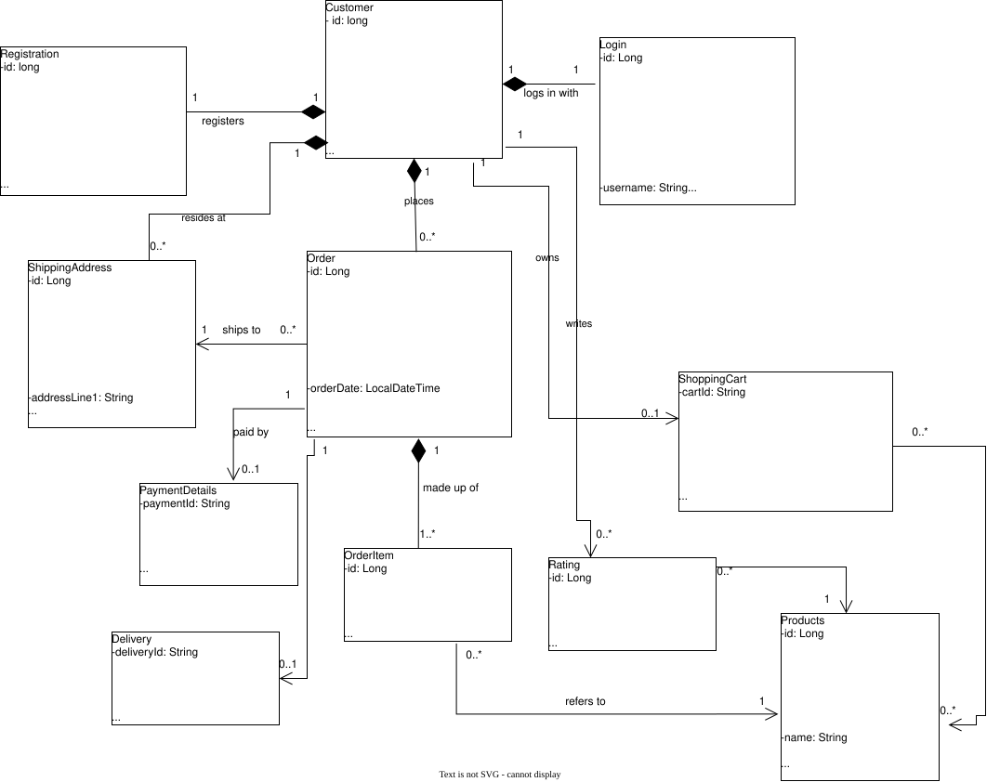

## Project Description

**TechStore E-commerce** is a full-stack online store for buying new and second-hand technology products such as laptops, desktops, phones, keyboards, mice and accessories. Customers can browse the catalogue, add items to a cart, check out and track their orders, while the backend keeps product stock, orders, payments and deliveries organised and consistent.

The system has two parts that work together:

- **Backend:** a Spring Boot REST API that holds the business logic and stores data in a MySQL database (`ecommerce_db`).
- **Frontend:** a React web app (branded **TechVault**) that customers use in the browser and that talks to the backend through the `/api` endpoints.

### What the system does

- **Product catalogue:** view all products with pictures, search by name, filter by category (Laptop, Desktop, Phone, Monitor, Keyboard, Mouse, Accessory), see whether an item is new or second-hand, and check which items are in stock.
- **Customers (no sign-in this term):** security has not been covered yet, so there is no login or registration. A customer's details are saved in the database when they check out, and an existing customer is found again by email.
- **Shopping cart:** add products, change quantities and remove items. The cart is stored in the database (`shopping_carts` and `shopping_cart_items`) and identified by an ID kept in the browser, so it is still there after a refresh.
- **Checkout and orders:** place an order with a shipping address. The system saves the customer and the order, calculates the total and reduces the stock automatically.
- **Order tracking:** every order moves through the statuses `PENDING`, `CONFIRMED`, `SHIPPED`, `DELIVERED` or `CANCELLED`, and customers can look up their orders by email.
- **Order cancellation:** an order that is still cancellable can be cancelled, and the stock for its items is returned to the shop.
- **Admin page:** at `/admin` an admin can add, edit and delete products, change prices and stock, mark items as new or second-hand, and upload product pictures. The admin sign-in is a temporary placeholder (not real security) until security is covered.
- **Payments, delivery and ratings:** these are part of the data model (tables exist) but are not used on the website yet.
- **Pricing rules:** prices include 15% South African VAT, and orders of R500 or more qualify for free delivery.

### Main entities

The system is built around 11 domain classes: `Customer`, `Registration`, `Login`, `ShippingAddress`, `ShoppingCart`, `Products`, `Order`, `OrderItem`, `PaymentDetails`, `Delivery` and `Rating`. A customer places many orders, and each order is made up of one or more order items that refer to products.

### Technologies used

| Layer | Technology |
|-------|------------|
| Backend | Java 21, Spring Boot 3.3, Spring Data JPA, Bean Validation |
| Database | MySQL |
| Frontend | React 19, Vite, React Router, Axios, Tailwind CSS |
| Testing | Spring Boot Test (JUnit) for factories, repositories, services and controllers |

### Architecture

The backend follows a layered design: **Controller** (REST endpoints) → **Service** (business rules) → **Repository** (database access) → **Domain** (entities). Objects are created through **factory** classes, and shared logic such as pricing and order formatting lives in **util** classes.

### Running the project

**You need:** Java 21 (JDK), MySQL, and Node.js 18 or newer.

1. **Start MySQL.** The `ecommerce_db` database is created automatically on first run.
2. **Set your MySQL password.** Open `src/main/resources/application.properties` and change `spring.datasource.username` and `spring.datasource.password` to match your MySQL login.
3. **Start the backend** (runs at `http://localhost:8080`). Either run `TechStoreApplication` in IntelliJ, or from the project folder run:
   ```bash
   ./mvnw spring-boot:run
   ```
   (on Windows PowerShell: `.\mvnw spring-boot:run`)

   On the first start the database tables are created and 14 starter products are added automatically.
4. **Start the frontend** (runs at `http://localhost:3000`) in a second terminal:
   ```bash
   cd frontend
   npm install
   npm run dev
   ```
5. **Open the website** at `http://localhost:3000`.

**Admin page:** go to `http://localhost:3000/admin` and sign in with username `admin` and password `admin123` (temporary placeholder, not real security). Pictures uploaded here are saved in the `uploads/products` folder.

**Product pictures:** the starter products use pictures in `frontend/public/images/products/`.

**Tests:** the automated tests use a separate database called `ecommerce_test` (set in `src/test/resources/application.properties`), so they do not change the website's data. If your MySQL password is different, change it in that file too.

**Troubleshooting**
- *No products on the home page:* the backend is not running, or MySQL is not running. Start the backend and refresh.
- *Backend will not start:* check the MySQL username and password in `application.properties`.
- *Pictures are missing:* the product's picture file is not in `frontend/public/images/products/` (starter products) or `uploads/products/` (admin uploads).


   
### UML Diagram

