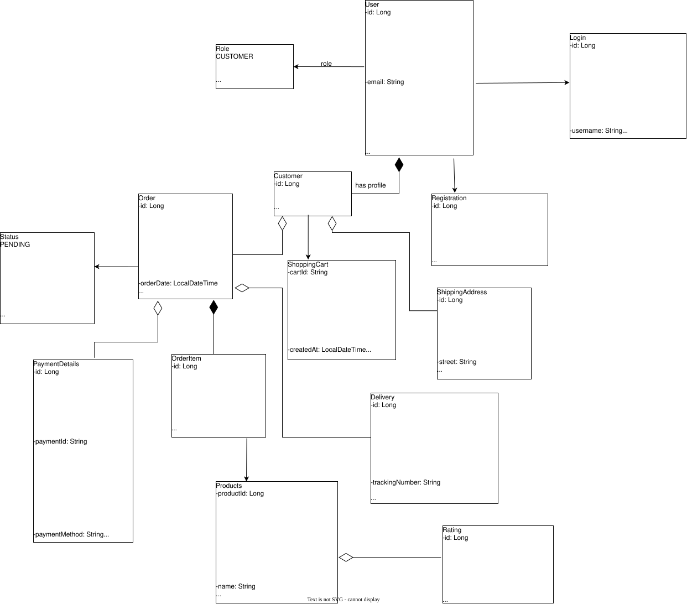

# TechStore E-commerce (TechVault)

ADP372S Capstone Project, Cape Peninsula University of Technology (CPUT)

**TechStore E-commerce** is a full-stack online store for buying new and second-hand technology products such as laptops, desktops, phones, monitors, keyboards, mice and accessories. Customers can register, browse the catalogue, add items to a cart, check out and track their orders, while the backend keeps stock, orders, payments and deliveries organised and consistent. Administrators manage the shop from a protected admin dashboard.

## Group Members

| Name | Student number | Role |
|------|----------------|------|
| Pertunia Fezile Sifunda | 221692568      | Group Leader |
| Sinentlantla Slayi | 222133872      | Group member |
| Abongile Zinja | 222907029      | Group member |

## Problem Description, Aims and Objectives

**Problem:** small technology resellers often sell through social media and messages, which makes stock, orders, payments and deliveries hard to track and gives customers no secure account or order history.

**Aim:** build a secure web store where customers can buy technology products and track their orders, and where the owner can manage products, orders, customers, payments, deliveries and enquiries in one place.

**Objectives**
1. Model the business with Domain Driven Design: entities, factories, repositories, services and controllers.
2. Persist all data in a relational database (MySQL).
3. Provide a React front end that talks to the back end through a REST API.
4. Secure the application with authentication (who you are) and authorisation (what you may do).
5. Verify the solution with automated tests at every layer.

## What the System Does

- **Product catalogue:** view products with pictures, search by name, filter by category (Laptop, Desktop, Phone, Monitor, Keyboard, Mouse, Accessory, General), see whether an item is new or second-hand, and check stock.
- **Accounts and security:** customers register and sign in; admins sign in through a separate admin login. See *Application Security* below.
- **Shopping cart:** add products, change quantities and remove items. The cart is stored in the database.
- **Checkout and orders:** place an order with a shipping address and payment method. The system saves the order, calculates the total (prices include 15% South African VAT, with free delivery above a set order value) and reduces stock automatically.
- **Order tracking:** orders move through `PENDING`, `CONFIRMED`, `SHIPPED`, `DELIVERED` or `CANCELLED`. Customers see their own orders and delivery progress.
- **Order cancellation:** a cancellable order can be cancelled and its stock is returned to the shop.
- **Ratings and enquiries:** customers can rate products and send enquiries through the contact form.
- **Admin dashboard (`/admin`):** statistics, product management (add, edit, delete, upload pictures), orders (update status), customers (enable or disable accounts), payments, deliveries and enquiries.

## Domain Model

The domain layer has 13 entity classes and one enumeration:

`User`, `Customer`, `Registration`, `Login`, `ShippingAddress`, `ShoppingCart`, `Products`, `Order`, `OrderItem`, `PaymentDetails`, `Delivery`, `Rating`, `Enquiry`, and the `Role` enum (`CUSTOMER`, `ADMIN`).

A `User` holds the account identity (email, hashed password, role). A `Customer` is linked to a `User`. A customer places many orders, and each order is made up of one or more order items that refer to products.

## Technologies Used

| Layer | Technology |
|-------|------------|
| Backend | Java 21, Spring Boot 3.3, Spring Data JPA, Bean Validation, Spring Security |
| Security | JWT (jjwt 0.12.5), BCrypt password hashing |
| Database | MySQL (managed with MySQL Workbench) |
| Frontend | React 19, Vite, React Router, Axios, Tailwind CSS |
| Testing | Spring Boot Test (JUnit 5, MockMvc) |

## Architecture (Domain Driven Design)

The backend follows a layered DDD design:

```
React front end  ->  Controller  ->  Service  ->  Repository  ->  MySQL
                       (REST)     (business rules)  (JPA)         (entities)
```

| DDD building block | Package | Purpose |
|--------------------|---------|---------|
| Entities | `domain` | Objects with identity and rules (`Order`, `Customer`, `User`, ...) |
| Factories | `factory` | Create valid entities in one place (`OrderFactory`, `UserFactory`, ...) |
| Repositories | `repository` | Database access through Spring Data JPA interfaces |
| Services | `service` | Business logic (stock, totals, cancelling an order) |
| Controllers | `controller` | REST endpoints under `/api/...` |
| Security | `security` | Authentication, authorisation, policies, tokens |
| Utilities | `util` | Shared logic such as pricing and order formatting |

## Application Security

### Authentication (who are you?)
- **Registration:** a customer registers with name, email, phone, address and password. The password must be at least 8 characters with an uppercase letter, a lowercase letter, a digit and a special character (`PasswordPolicy`).
- **Password storage:** passwords are never stored in plain text. They are hashed with **BCrypt (strength 12)** and the hash is never sent to the browser (`@JsonIgnore`).
- **Login:** the user sends email and password. If they are correct the server returns a signed **JWT (JSON Web Token)** that contains the email, role and expiry (24 hours).
- **Stateless sessions:** the front end sends the token in the `Authorization: Bearer <token>` header on every request. A `JwtAuthenticationFilter` checks the signature and expiry on each request and rebuilds the logged-in user. The server keeps no session.
- **Brute-force protection:** five wrong passwords for an email lock that email for 15 minutes (`LoginAttemptService`).
- **Password reset:** the user requests a 6-digit code that expires after 15 minutes, can be used once, and is locked after 5 wrong tries. The reply is the same whether or not the email exists, so it cannot be used to discover accounts.
- **Email verification (optional):** switched off by default. Setting `app.auth.require-email-verification=true` makes new accounts start disabled until the emailed code is entered.

### Authorisation (what may you do?)
Authorisation is role based (`CUSTOMER`, `ADMIN`) and enforced on the server in two layers:

1. **URL rules** in `SecurityConfig`:
    - Public: product browsing, images, sign-in, registration and the contact form.
    - Admin only: product create/update/delete, the admin dashboard API, listing all orders, updating order status, listing customers, user management, payment and delivery management.
    - Everything else requires a signed-in user.
2. **Ownership policies** (the Policy pattern): `OrderOwnershipPolicy` and `CustomerOwnershipPolicy` make sure a customer can only view, cancel or place orders for **their own** account. Admins may access any record. A customer who tries to open someone else's order receives `403 Forbidden`.

The React front end also hides admin pages from non-admins (`RequireAdmin`), but this is only for convenience. The real protection is on the server.

### Other protections
- **CORS** only allows the front end's origins.
- **Input validation** with Bean Validation on request bodies.
- **Clean error responses:** security errors return JSON (`401`, `403`) instead of stack traces.
- **Card data:** only the masked card number, last four digits, holder name and expiry are stored. The CVV is never saved.
- **Secrets:** the database password and JWT secret can be supplied through the environment variables `DB_PASSWORD` and `JWT_SECRET`.

## Running the Project

**You need:** Java 21 (JDK), MySQL, and Node.js 18 or newer.

1. **Database.** Start MySQL. Either let the app create the `ecommerce_db` database automatically on first run, or import the packaged `ecommerce_db.sql` file from this project using MySQL Workbench (*Server -> Data Import*).
2. **Set your MySQL password.** Open `src/main/resources/application.properties` and set `spring.datasource.username` and `spring.datasource.password` (or set the `DB_PASSWORD` environment variable).
3. **Start the backend** (runs at `http://localhost:8080`). Run `TechStoreApplication` in IntelliJ, or from the project folder run `mvn spring-boot:run`. On the first start the tables are created and 14 starter products and the default admin account are added automatically.
4. **Start the frontend** (runs at `http://localhost:3000`) in a second terminal:
   ```bash
   cd frontend
   npm install
   npm run dev
   ```
5. **Open the website** at `http://localhost:3000`.

**Default admin login:** go to `http://localhost:3000/admin/login` and sign in with `admin@techvault.co.za` / `Admin@123`. Customers create their own account through **Register**.

**Product pictures:** starter products use pictures in `frontend/public/images/products/`. Pictures uploaded by the admin are saved in `uploads/products/`.

**Optional email setup:** to receive password-reset (or verification) codes as real emails during development, run [Mailpit](https://github.com/axllent/mailpit) (SMTP on port 1025, inbox at `http://localhost:8025`). Without a mail server the code is printed in the backend console instead. For demos only, `app.auth.expose-codes=true` returns the code in the API response.

## Tests

Automated tests cover factories, repositories, services and controllers. They use a separate database called `ecommerce_test` (set in `src/test/resources/application.properties`) so they do not change the website's data. Run them with `mvn test`. If your MySQL password is different, change it in that file too.

## Troubleshooting

- *No products on the home page:* the backend or MySQL is not running. Start them and refresh.
- *Backend will not start:* check the MySQL username and password in `application.properties`.
- *Pictures are missing:* the picture file is not in `frontend/public/images/products/` or `uploads/products/`.
- *"Too many failed login attempts":* wait 15 minutes or restart the backend, because the lock is kept in memory.

## UML Diagram


